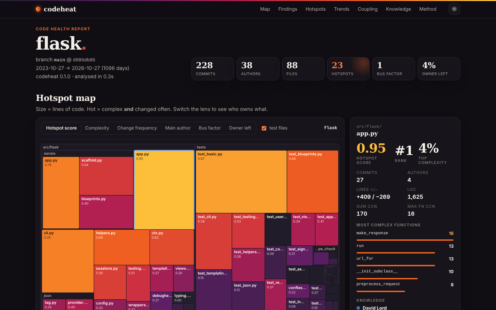

# codeheat

**Find the code that actually hurts.** codeheat combines your git history with code complexity to show where bugs and slowdowns cluster: **hotspots** (complex files that change all the time), **hidden coupling** (files that always change together), and **knowledge risks** (code only one person understands — or that nobody left on the team wrote).

```bash
pip install git+https://github.com/rishitmpatel/codeheat
cd your-repo
codeheat                          # terminal report
codeheat --html report.html       # interactive, single-file report to share
```

**Live example:** [the Flask repository](https://rishitmpatel.github.io/codeheat/) (3 years of history)



## Why

Most code is rarely touched, so its quality barely matters. A small set of files gets changed in almost every pull request — and when those files are also complex, that is where bugs, slow reviews and onboarding pain concentrate. Static analysis alone can't see this; it doesn't know which code you *work in*. Your version control history does.

This is the behavioural code analysis popularised by Adam Tornhill's *Your Code as a Crime Scene* (and commercial tools like CodeScene), as a free, local, one-command tool for any git repo in 20+ languages.

## What you get

```text
Findings
 1. 🔴 src/requests/models.py: changed in 10% of all commits, complexity 196 (top 11%),
       3 functions over CCN 15 — refactor candidate #1
 2. 🔴 src/requests/utils.py: changed in 7% of all commits, complexity 201 (top 7%),
       3 functions over CCN 15 — refactor candidate #2
 ...
 6. 🟠 5 of the top 10 hotspots are >80% written by one person
 7. 🟠 Repository bus factor is 1
```

| Analysis | What it tells you |
|---|---|
| **Hotspots** | Files ranked by change frequency × complexity, with their most complex functions. Your refactoring shortlist. |
| **Complexity trends** | Whether your top hotspots are getting better or worse over time. |
| **Change coupling** | Files that change together in commit after commit — especially across modules, which usually means a missing abstraction or a hidden dependency. |
| **Knowledge map** | Main author and bus factor per file and folder, and code whose main author hasn't committed in 6 months. |
| **Findings** | A short, prioritised list in plain language. |

The HTML report is a single file with no external requests. It has a zoomable hotspot map (switch lenses: complexity, change frequency, main author, bus factor, owner left), sortable tables with per-function detail and trend sparklines, a coupling matrix, and light/dark themes.

## Options

```bash
codeheat --since "6 months ago" --until 2026-01-01 --branch main
codeheat --include "src/**" --exclude "**/migrations/**"
codeheat --json out.json            # schema: docs/json-schema.md
codeheat --markdown summary.md      # e.g. for PR comments
codeheat --fail-on "hotspot>0.9"    # CI gate (also: "ccn>30", --max-ccn N)
codeheat --include-bots             # bots are excluded by default
```

Vendored code, build output, lockfiles, minified and generated files are skipped by default; add your own patterns to a `.codeheatignore` (gitignore syntax). Author identities are merged through `.mailmap`, matching emails and GitHub noreply addresses.

## In CI (GitHub Actions)

```yaml
- uses: actions/checkout@v4
  with:
    fetch-depth: 0            # full history is required
- uses: rishitmpatel/codeheat@main
  with:
    since: 12 months ago
    fail-on: hotspot>0.95     # optional
```

The action writes the findings to the job summary and uploads the HTML and JSON reports as an artifact.

## How the numbers are computed

- **History:** one pass over `git log --no-merges -M --numstat` in the window (default: last 12 months). Renames are followed so a moved file keeps its history; pure moves don't count as changes; commits touching more than 50 files are ignored for coupling.
- **Complexity:** cyclomatic complexity per function via [lizard](https://github.com/terryyin/lizard) (C/C++, C#, Java, JavaScript/TypeScript, Python, Go, Rust, Kotlin, Swift, Ruby, PHP, Scala, Lua, …). Languages lizard can't parse fall back to an indentation-based proxy, marked as such and only ranked against each other. Results are cached by blob hash, so re-runs are fast.
- **Hotspot score:** `norm(commits) × norm(complexity)`, where `norm` blends percentile rank and log scaling so a single huge file doesn't flatten everything else. Test files are shown but never listed as refactor candidates.
- **Coupling:** `degree = shared commits / min(commits of either file)`; shown when ≥ 5 shared commits and ≥ 30% degree.
- **Knowledge:** main author by lines added in the window; bus factor = fewest people covering 50% of added lines.

Full details: [docs/json-schema.md](docs/json-schema.md).

## Speed

| Repository | Commits analysed | Time |
|---|---|---|
| requests (12 months) | 109 | 1.8 s |
| express (12 months) | 95 | 2.8 s |
| django (12 months) | 1,016 | 12.7 s cold · 2.5 s cached |
| django (since 2013) | 20,979 | 29 s |

Most of the time on big histories is `git log` itself. Use a full clone: partial (`--filter=blob:none`) clones work but skip line counts.

## Caveats

These are signals for conversations, not grades for people. "Lines added" rewards typing; squash-merge workflows credit whoever merged; a bus factor of 1 on a small project is normal. Use the report to decide where to look first.

## Development

```bash
pip install -e . pytest
python -m pytest -q      # 36 tests on scripted synthetic repos
```

## License

MIT
